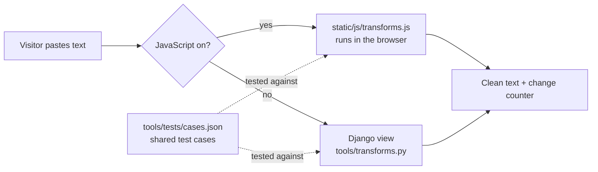

<div align="center">


# TidyText

**Clean up messy text in seconds.**

Fix broken line breaks from PDFs, extra spaces, duplicate lines, invisible characters and letter case, count words, and more. Free, instant, and private: your text never leaves your browser.

[](https://github.com/Shahryartariq/tidytext/actions/workflows/ci.yml)


[](LICENSE)

[Deploy your own](#deploy-to-vercel) · [Report a bug](https://github.com/Shahryartariq/tidytext/issues) · [Request a tool](https://github.com/Shahryartariq/tidytext/issues)

</div>

<p align="center">
  
  &nbsp;
  
</p>

## Table of contents

- [What TidyText does](#what-tidytext-does)
- [Features](#features)
- [Languages and tech stack](#languages-and-tech-stack)
- [How it works](#how-it-works)
- [Getting started](#getting-started)
- [Make shortcuts](#make-shortcuts)
- [Testing and quality](#testing-and-quality)
- [Deploy to Vercel](#deploy-to-vercel)
- [Run with Docker](#run-with-docker)
- [Configuration](#configuration)
- [Google Analytics](#google-analytics)
- [Security and privacy](#security-and-privacy)
- [SEO](#seo)
- [Project structure](#project-structure)
- [Adding a tool](#adding-a-tool)
- [Roadmap](#roadmap)
- [License](#license)

## What TidyText does

Text rarely survives being copied from one place to another. A PDF breaks every line in the middle of a sentence and splits words with hyphens. A web page brings hidden zero-width characters and odd spaces. A list arrives full of duplicates, or someone typed with caps lock on.

TidyText fixes all of that in one place:

1. **Paste** your text, open a `.txt` file, or drag one onto the page.
2. **Choose what to fix.** Combine as many options as you like; the clean version updates as you type.
3. **Copy or download** the result.

A highlighted counter shows exactly what changed, for example `1,240 characters −312`, so you can see the cleaning worked.

| Problem | Fix in TidyText |
| --- | --- |
| Text from a PDF breaks at the end of every line | **Join lines, keep paragraphs** |
| PDF splits words across lines ("infor- mation") | **Fix hyphenated words** |
| Everything should be on one line | **Remove all line breaks** |
| Double spaces, tabs, spaces at line ends | **Remove extra spaces** |
| Blank lines everywhere | **Remove empty lines** |
| A list full of repeats | **Remove duplicate lines** |
| A list in random order | **Sort lines** A to Z or Z to A (ignores case and accents) |
| Curly quotes and long dashes break code or CSV | **Straight quotes** |
| Copied HTML instead of text | **Remove HTML tags** (decodes entities, keeps line breaks) |
| Zero-width spaces and soft hyphens break code or passwords | **Remove invisible characters** |
| Commas, quotes and dashes in the way | **Remove punctuation** (works in any language) |
| A word needs changing everywhere | **Find and replace** (type `\n` for a new line) |
| Caps lock was on | **Sentence case, lowercase, UPPERCASE, Title Case** |
| "Your good", "dont", "better then" | **Fix grammar**: common South Asian English slips, only where the meaning is clear |
| Wordy, stiff phrasing | **Paraphrase**: about 100 hand-checked rewrites ("is able to" becomes "can"), or **Paraphrase with AI**, an optional model that runs on your device |
| Sounds like a robot wrote it | **Humanize**: plain words, contractions, then everyday slips ("you're good" becomes "your good") |
| How long is this? | **Word counter**: words, characters, sentences, paragraphs, reading and speaking time |

## Features

- **19 tools, one page.** Every option can be combined, and each tool also has its own landing page such as `/fix-pdf-line-breaks/`, `/word-counter/`, `/paraphrasing-tool/` and `/ai-text-humanizer/`.
- **Instant.** Cleaning runs in the browser as you type and stays responsive on long documents (up to 200,000 characters).
- **Private.** Text and files are processed on your device. Nothing is uploaded, stored or logged.
- **Works without JavaScript.** The same form falls back to the server, which runs an identical Python implementation.
- **Input your way.** Paste button, open a text file, or drag and drop.
- **Output your way.** Copy to clipboard or download as `.txt`.
- **Light and dark themes**, automatic or chosen by the visitor.
- **Responsive and accessible.** Works on phones, keyboard friendly, labelled controls, visible focus, screen-reader announcements and reduced-motion support.
- **Fast.** No CSS or JavaScript frameworks, no web fonts, about 5 KB of HTML per page (gzipped), cached on the CDN.

## Languages and tech stack

**Languages**

| Language | Used for | Share of code |
| --- | --- | --- |
| **Python** | Django app, text transformations, tests, build scripts | ~48% |
| **CSS** | All styling, themes and responsive layout (no framework) | ~28% |
| **JavaScript** (ES modules) | In-browser cleaning, live updates, copy, paste, files, theme | ~13% |
| **HTML** (Django templates) | Pages, forms and structured data | ~10% |

**Stack**

| Layer | Technology |
| --- | --- |
| Backend | [Django 6.1](https://www.djangoproject.com/) on Python 3.12+ (stateless: no database, sessions or cookies) |
| Frontend | Django templates, plain CSS with custom properties, vanilla JavaScript |
| Static files | [WhiteNoise](https://whitenoise.readthedocs.io/) (gzip, cache headers) or the Vercel CDN |
| App server | [Gunicorn](https://gunicorn.org/) |
| Hosting | [Vercel](https://vercel.com/) (serverless Python + CDN), or any Docker host |
| Container | Docker: multi-stage build, non-root user, read-only filesystem |
| Testing | Django test runner, Node.js test runner, headless Chrome checks |
| Code quality | [Ruff](https://docs.astral.sh/ruff/) (lint, format, security rules), `manage.py check --deploy` |
| CI/CD | GitHub Actions: tests on every push, Docker image to GHCR on every release |

Runtime dependencies: Django, WhiteNoise and Gunicorn. Nothing else.

## How it works



- The transformations exist twice, once in Python and once in JavaScript, and both are tested against the **same 51 cases**. So the instant browser result and the no-JavaScript fallback always match.
- Options run in a fixed order: find and replace, HTML removal, invisible characters, quotes, hyphenation, grammar fixes, paraphrase, humanize, punctuation, line breaks, empty lines, spaces, duplicates, sorting, then letter case.
- Pages are identical for every visitor (no cookies), so Vercel's CDN caches them. Most visits never reach Django.

## Getting started

**Requirements:** Python 3.12+, `make`, and Node.js 20+ for the JavaScript tests. On Windows, `make` works from PowerShell, cmd or Git Bash as long as [Git for Windows](https://git-scm.com/download/win) is installed (the recipes run in its bash). WSL or Docker work too.

```bash
git clone https://github.com/Shahryartariq/tidytext.git tidytext
cd tidytext
make install   # create .venv and install dependencies
make dev       # http://localhost:8000
```

## Make shortcuts

Run `make` on its own to see this list in your terminal.

| Command | What it does |
| --- | --- |
| `make install` | Create `.venv` and install dependencies |
| `make env` | Create `.env` with a fresh secret key |
| `make dev` | Development server with auto-reload |
| `make serve` | Run like production locally, with Gunicorn |
| `make test` | Python and JavaScript tests |
| `make lint` / `make format` | Check or fix code style with Ruff |
| `make check` | Django's production deployment checks |
| `make ci` | Everything CI runs |
| `make docker-build` | Build the production image |
| `make docker-run` | Build and run the image on port 8000 |
| `make up` / `make down` / `make logs` | Docker Compose |
| `make secret` | Print a new `DJANGO_SECRET_KEY` |
| `make cases` | Regenerate the shared test cases |
| `make assets` | Redraw the icons and social sharing card |
| `make release VERSION=x.y.z` | Run CI checks, then tag and push a release |

## Testing and quality

```bash
make test    # 36 Python tests + 33 JavaScript cases
make lint    # Ruff: style, bugs and security rules
make check   # Django production checks (HTTPS, HSTS, secret key, ...)
```

GitHub Actions runs all three on every push and pull request, then builds the Docker image and smoke-tests the running container.

## Deploy to Vercel

TidyText includes everything Vercel needs (`vercel.json`, `api/index.py`, `requirements.txt`). Vercel's free Hobby plan covers personal, non-commercial projects.

1. Sign in to [vercel.com](https://vercel.com) with GitHub and choose **Add New → Project**.
2. Import this repository. Leave the build settings as they are.
3. Open **Environment Variables** and add:

   | Name | Value |
   | --- | --- |
   | `DJANGO_SECRET_KEY` | A long random string, for example from `make secret`. **Required.** |
   | `SITE_URL` | Your public address, such as `https://tidytext.vercel.app`. Recommended for canonical links and the sitemap. |
   | `GA_MEASUREMENT_ID` | Optional. Your Google Analytics 4 ID. |
   | `DJANGO_ALLOWED_HOSTS` | Only for a custom domain, such as `tidytext.app,www.tidytext.app`. Vercel's own domains are allowed automatically. |

4. Click **Deploy**. Every push to `main` deploys again, and pull requests get preview links.

## Run with Docker

```bash
make env     # create .env with a secret key
make up      # http://localhost:8000
```

Or without Compose:

```bash
docker build -t tidytext .
docker run --rm -p 8000:8000 -e DJANGO_SECRET_KEY=change-me tidytext
```

Each tagged release also publishes an image to GitHub Container Registry:

```bash
docker run --rm -p 8000:8000 -e DJANGO_SECRET_KEY=change-me ghcr.io/shahryartariq/tidytext:latest
```

## Configuration

All settings come from environment variables. See [`.env.example`](.env.example).

| Variable | Default | Purpose |
| --- | --- | --- |
| `DJANGO_SECRET_KEY` | (none) | Required in production |
| `DJANGO_DEBUG` | `0` | `1` for local development only |
| `DJANGO_ALLOWED_HOSTS` | `localhost,127.0.0.1` | Extra host names; Vercel URLs are added automatically |
| `SITE_URL` | request host | Public base URL for canonical links, sitemap and social cards |
| `GA_MEASUREMENT_ID` | (none) | Optional Google Analytics 4 ID, such as `G-ABC123XYZ9` |
| `DJANGO_SECURE_SSL_REDIRECT` | `0` | Redirect HTTP to HTTPS (Vercel already does this) |
| `DJANGO_HSTS_SECONDS` | `31536000` | HSTS max age in production |
| `WEB_CONCURRENCY` | CPU based, max 4 | Gunicorn workers (Docker) |

## Google Analytics

Don't paste Google's tag snippet into a template. The Content-Security-Policy blocks inline scripts, so it wouldn't run. Instead, set `GA_MEASUREMENT_ID` and redeploy. TidyText then:

- loads `gtag.js` plus a small static `analytics.js`, with no inline script;
- allows only Google's analytics domains in the security policy;
- updates the privacy page, About page and footer to say that Google Analytics is used.

Only page views are sent. The text people clean never goes to Google. If you have visitors from the EU or UK, check whether you need a cookie consent banner.

## Security and privacy

- **No stored data:** no database, no uploads, no accounts, no sessions. Gunicorn logs paths only, never request bodies.
- **Strict Content-Security-Policy** with no inline scripts or styles (the two pages with Paraphrase with AI also let its worker load the model runtime from jsDelivr), plus HSTS, `X-Frame-Options: DENY`, `nosniff`, Referrer-Policy, COOP, CORP and a restrictive Permissions-Policy.
- **Safe output:** user text is always escaped, never rendered as HTML.
- **Limits:** 200,000 characters per request, 1 MB request bodies, 5 MB files (read locally).
- **Secrets from the environment:** the app refuses to start in production without a secret key.
- **Small attack surface:** three runtime dependencies, no admin panel, no third-party scripts unless analytics is turned on or a visitor clicks Paraphrase with AI (which loads Transformers.js from jsDelivr into a worker and the model from Hugging Face; the text stays on the device).

Details and how to report a problem: [SECURITY.md](SECURITY.md).

## SEO

- One landing page per tool, each with its own title, description, heading and FAQs
- Canonical URLs, `sitemap.xml` and `robots.txt`
- Open Graph and Twitter cards with a 1200×630 image
- JSON-LD structured data: `WebApplication`, `FAQPage` and `BreadcrumbList`
- Fast, mobile-friendly pages with semantic HTML

## Project structure

```
├── api/index.py            # Vercel entry point
├── tidytext/               # Django project: settings, URLs, WSGI/ASGI
├── tools/
│   ├── transforms.py       # Text transformations (pure Python)
│   ├── catalog.py          # The 19 tools: presets, titles, page copy, FAQs
│   ├── views.py            # Pages, no-JS form fallback, robots.txt, health check
│   ├── middleware.py       # Security and cache headers
│   ├── sitemaps.py
│   └── tests/              # Python tests + cases.json shared with JavaScript
├── templates/              # Base layout, tool page, about, privacy, error pages
├── static/
│   ├── css/app.css         # All styles, light and dark themes
│   ├── js/transforms.js    # Browser version of transforms.py
│   ├── js/app.js           # Live updates, copy, paste, files, stats
│   ├── js/theme.js         # Theme switcher
│   ├── js/analytics.js     # Optional Google Analytics loader
│   └── img/                # Icons and social sharing card
├── tests/js/               # JavaScript tests (node --test)
├── scripts/                # Test-case and image generators
├── Dockerfile, docker-compose.yml, gunicorn.conf.py
├── vercel.json
└── Makefile
```

## Adding a tool

1. Add a `Tool(...)` entry to `tools/catalog.py` with a slug, page copy and preset options.
2. If it needs a new transformation, add it to both `tools/transforms.py` and `static/js/transforms.js`, add an example to `scripts/case_inputs.json`, then run `make cases` and `make test`.

The page, sitemap entry, footer link and structured data are created automatically.

## Roadmap

What's done, what's next and what was ruled out (with reasons) is in [ROADMAP.md](ROADMAP.md).

## License

[MIT](LICENSE) © [Muhammad Shehryar](https://github.com/Shahryartariq)
